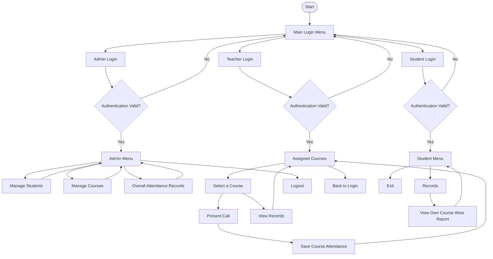

# 📚 Smart Attendance System

<p align="center">
  
  
  
  
</p>

A menu-driven **Smart Attendance System developed in C** for the CSE 1102 Structured Programming Lab at Khulna University of Engineering & Technology (KUET).

The system organizes student attendance by course and provides separate workflows for administrators, teachers, and students. It uses modular C source files and text-file storage to manage student information, courses, course assignments, attendance records, and attendance percentages.

---

## 📑 Table of Contents

* [Project Overview](#-project-overview)
* [Features](#-features)
* [System Workflow](#-system-workflow)
* [Admin Module](#-admin-module)
* [Teacher Module](#-teacher-module)
* [Student Site](#-student-site)
* [Attendance Calculation](#-attendance-calculation)
* [Project Structure](#-project-structure)
* [File Storage](#-file-storage)
* [Programming Concepts](#-programming-concepts)
* [Installation and Execution](#-installation-and-execution)
* [Contributors](#-contributors)

---

## 🎯 Project Overview

Manual attendance management can become difficult when students take several courses. Maintaining separate records, calculating percentages, and checking attendance history can take considerable time.

The Smart Attendance System addresses this problem through a structured, menu-driven C application.

### Project objectives

* Organize attendance records separately for each course.
* Provide role-based access for administrators, teachers, and students.
* Allow teachers to manage attendance for their assigned courses.
* Allow students to review their own course-wise attendance.
* Calculate attendance percentages automatically.
* Store information in text files for later use.
* Demonstrate structured programming, modular design, and file handling in C.

---

## ✨ Features

<table>
  <tr>
    <td width="50%" valign="top">
      <h3>🔐 Role-Based Access</h3>
      Separate login workflows for administrators, teachers, and students.
    </td>
    <td width="50%" valign="top">
      <h3>📚 Course-Wise Records</h3>
      Attendance information is organized by course instead of relying on one combined attendance record.
    </td>
  </tr>
  <tr>
    <td width="50%" valign="top">
      <h3>👨‍🏫 Teacher Tools</h3>
      Assigned-course selection, attendance marking, and course-specific record viewing.
    </td>
    <td width="50%" valign="top">
      <h3>👨‍🎓 Student Site</h3>
      Students can access their own attendance report and review attendance percentages across courses.
    </td>
  </tr>
  <tr>
    <td width="50%" valign="top">
      <h3>🛠️ Administration</h3>
      Student management, course management, and overall attendance record viewing.
    </td>
    <td width="50%" valign="top">
      <h3>💾 Persistent Storage</h3>
      Local text files store student, course, assignment, and attendance data.
    </td>
  </tr>
</table>

Additional development updates include duplicate-registration checks, student-registration sorting, course-assignment management, unassignment support, and improvements to course-wise records.

---

## 🔄 System Workflow

The following diagram represents the main navigation and the three role-based workflows.



### Workflow summary

1. The program displays the main login menu.
2. The user selects the appropriate role.
3. After successful authentication, the program opens the relevant menu.
4. Administrators manage students, courses, and overall attendance records.
5. Teachers select an assigned course before marking attendance or viewing its records.
6. Students open their records to view their own course-wise attendance report.
7. Relevant data is read from or saved to local text files.

---

## 🛠️ Admin Module

The administrator menu provides access to the following options:

```text
ADMIN MENU

1. Manage Students
2. Manage Courses
3. Overall Attendance Record View
4. Logout
```

### Administrative capabilities

* Access student-management operations.
* Manage course information.
* Review overall attendance records.
* Use the course-assignment data maintained by the system.
* Benefit from registration improvements such as duplicate checking and sorting, where implemented.

The current menu does not include a separate **Manage Teachers** option.

---

## 👨‍🏫 Teacher Module

Teachers can log in and select from their assigned courses.

```text
TEACHER WORKFLOW

Teacher Login
     |
Assigned Courses
     |
Select Course
     |
+--------------------------+
| 1. Present Call          |
| 2. Records               |
| 3. Back to assigned      |
|    courses               |
+--------------------------+
```

### Teacher capabilities

* Log in with teacher credentials.
* View assigned courses.
* Select a course for attendance operations.
* Mark students present or absent for a session.
* View records for the selected course.
* Return to the assigned-course list.

Attendance data is stored using course-specific files, keeping records for different subjects separate.

---

## 👨‍🎓 Student Site

**The student experience is a separate role-based menu inside the console application.** It is not a separate web application.

### Student menu

```text
STUDENT MENU

1. Records
2. Exit
```

### What students can view

* Their own attendance records.
* Course codes and course names.
* Number of classes attended.
* Total classes held.
* Attendance percentage for each course.
* Low-attendance indications where implemented.

### Example course-wise report

| Course    | Present | Total | Attendance |
| --------- | ------: | ----: | ---------: |
| CSE 1101  |       5 |     5 |    100.00% |
| HUM 1108  |       2 |     3 |     66.67% |
| MATH 1107 |       0 |     1 |      0.00% |

*These figures are illustrative examples; actual results depend on the saved attendance files.*

The student report uses the logged-in student's identity to display their records, rather than requiring them to choose another student's roll number.

---
## 📊 Attendance Calculation

The system calculates a student's attendance percentage for each course using the number of classes attended and the total number of classes held.

**Formula:**

$$
\text{Attendance Percentage} =
\frac{\text{Classes Attended}}{\text{Total Classes Held}} \times 100
$$

**Example:** If a student attends 2 out of 3 classes:

$$
\frac{2}{3}\times100=66.67\%
$$

| Classes Attended | Total Classes Held | Attendance Percentage |
| ---------------: | -----------------: | --------------------: |
|                5 |                  5 |               100.00% |
|                2 |                  3 |                66.67% |
|                0 |                  1 |                 0.00% |

**Important considerations:**

* Attendance is calculated separately for each course.
* The total number of classes must be greater than zero before performing the division.
* The percentage should be calculated from the stored attendance counts, rather than adding or averaging previously calculated percentages.
* A 75% threshold may be used to identify low attendance where that warning feature is implemented.


## 🗂️ Project Structure

```text
Smart-Attendance-System/
│
├── .vscode/
│   ├── launch.json
│   └── tasks.json
│
├── data/
│   ├── command.txt
│   ├── course-assignments.txt
│   ├── courses.txt
│   ├── logininputs.txt
│   ├── student-new.txt
│   ├── teacher.txt
│   ├── <COURSE CODE>.txt
│   └── <COURSE CODE>-session.txt
│
├── features/
│   ├── course.c
│   ├── course.h
│   ├── managecourses.c
│   ├── managecourses.h
│   ├── present.c
│   ├── present.h
│   ├── RECORD.c
│   ├── record.h
│   ├── REGISTRATION.c
│   └── registration.h
│
├── src/
│   └── main.c
│
├── .gitignore
└── README.md
```

*The data directory may contain additional course-specific attendance and session files. The exact files present depend on the courses configured in the project.*

### Module responsibilities

| File                       | Responsibility                                              |
| -------------------------- | ----------------------------------------------------------- |
| `src/main.c`               | Main program, login navigation, and role-based menus        |
| `features/REGISTRATION.c`  | Student registration operations                             |
| `features/present.c`       | Attendance-taking operations                                |
| `features/RECORD.c`        | Attendance records and reporting                            |
| `features/course.c`        | Course-related operations and selection                     |
| `features/managecourses.c` | Administrative course management                            |
| Header files (`.h`)        | Function declarations and module interfaces                 |
| `data/*.txt`               | Persistent student, course, assignment, and attendance data |

---

## 💾 File Storage

The application uses text files rather than a database.

| File or pattern             | Purpose                                           |
| --------------------------- | ------------------------------------------------- |
| `student-new.txt`           | Student information                               |
| `courses.txt`               | Course information                                |
| `teacher.txt`               | Teacher information                               |
| `course-assignments.txt`    | Teacher-to-course assignments                     |
| `logininputs.txt`           | Login-related information                         |
| `<COURSE CODE>.txt`         | Attendance records for a course                   |
| `<COURSE CODE>-session.txt` | Session-level attendance information for a course |

File names and formats must remain consistent with the corresponding C modules so that records can be loaded and saved correctly.

---

## 💻 Programming Concepts

* **Structured programming:** Functions, conditions, loops, and menu-driven control flow.
* **Functions and modular design:** Separate source and header files for individual features.
* **Arrays and strings:** Handling student, course, and attendance information.
* **File handling:** Reading and writing persistent text-file records.
* **Pointers:** Passing data and working with function parameters where required.
* **Validation and sorting:** Checking registration input and organizing student records.
* **Calculations:** Computing attendance totals and percentages.

---

## ⚙️ Installation and Execution

### Requirements

* GCC compiler
* Windows Terminal or PowerShell, or a compatible terminal
* Git, if cloning the repository

### 1. Clone the repository

```powershell
git clone https://github.com/adilmahmudayon-hue/Smart-Attendance-System.git
cd Smart-Attendance-System
```

### 2. Compile the project

Run this command from the project root:

```powershell
gcc src/main.c features/REGISTRATION.c features/present.c features/RECORD.c features/course.c features/managecourses.c -Ifeatures -o attendance.exe
```

### 3. Run the program

```powershell
.\attendance.exe
```

### 4. Compile and run in one step

```powershell
gcc src/main.c features/REGISTRATION.c features/present.c features/RECORD.c features/course.c features/managecourses.c -Ifeatures -o attendance.exe; if ($LASTEXITCODE -eq 0) { .\attendance.exe }
```

Save your source-code changes before recompiling. Changes to the C source files require a new compilation; changes to existing text data files generally do not.

The repository also includes VS Code build/run configuration files under `.vscode/`.

---

## 👥 Contributors

* **Adil Mahmud Ayon** — [GitHub](https://github.com/adilmahmudayon-hue)
* **Antora Ghosh** — [GitHub](https://github.com/agantoraghosh-prog)
* **Mitaly Farzana Oishe** — [GitHub](https://github.com/mitalyoyshe)

---

## 🔗 Repository

[Smart Attendance System on GitHub](https://github.com/adilmahmudayon-hue/Smart-Attendance-System)

Developed as a CSE 1102 Structured Programming Lab project at **Khulna University of Engineering & Technology (KUET)**.
