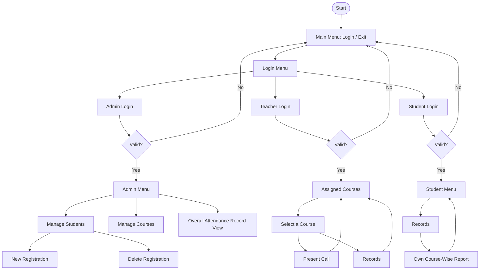

# 📚 Smart Attendance System

<p align="center">
  
  
  
  
  
</p>

A menu-driven **Smart Attendance System developed in C** for the CSE 1102 Structured Programming Lab at Khulna University of Engineering & Technology (KUET).

The system organizes student attendance **course by course** and provides three separate role-based workflows: **Admin**, **Teacher**, and **Student**. It is built from modular C source files, compiled from the terminal with GCC or the included `Makefile`, and stores all data in plain text files.

---

## 📑 Table of Contents

* [Project Overview](#-project-overview)
* [Features](#-features)
* [System Workflow](#-system-workflow)
* [Admin Module](#-admin-module)
* [Teacher Module](#-teacher-module)
* [Student Module](#-student-module)
* [Attendance Calculation](#-attendance-calculation)
* [Project Structure](#-project-structure)
* [File Storage](#-file-storage)
* [Programming Concepts](#-programming-concepts)
* [Build and Run](#-build-and-run)
* [Known Limitations and Future Work](#-known-limitations-and-future-work)
* [Contributors](#-contributors)

---

## 🎯 Project Overview

Manual attendance management becomes difficult when students take several courses. Keeping separate records, calculating percentages, and checking attendance history takes considerable time and is error-prone.

This project solves that with a structured, menu-driven C application where each course has its own attendance data, teachers only see the courses assigned to them, and students can only see their own records.

### Project objectives

* Organize attendance records separately for each course.
* Provide role-based access for administrators, teachers, and students.
* Let teachers take attendance and view records only for their assigned courses.
* Let students log in with their roll number and view their own course-wise attendance.
* Calculate attendance percentages automatically from stored counts.
* Store information in text files so data persists between runs.
* Demonstrate structured programming, modular design, multi-file compilation, and file handling in C.

---

## ✨ Features

<table>
  <tr>
    <td width="50%" valign="top">
      <h3>🔐 Role-Based Login</h3>
      Separate login for Admin (ID + password), Teacher (ID + password checked against <code>teacher.txt</code>), and Student (roll + password checked against <code>student-new.txt</code>).
    </td>
    <td width="50%" valign="top">
      <h3>📚 Course-Wise Records</h3>
      Each course keeps its own attendance file and session file, instead of one combined attendance record.
    </td>
  </tr>
  <tr>
    <td width="50%" valign="top">
      <h3>👨‍🏫 Teacher Tools</h3>
      Dynamic list of assigned courses, <b>Present Call</b> for attendance marking, and per-course record viewing.
    </td>
    <td width="50%" valign="top">
      <h3>👨‍🎓 Student Records</h3>
      Students see their own attendance for each course: classes attended, total classes, and percentage.
    </td>
  </tr>
  <tr>
    <td width="50%" valign="top">
      <h3>🛠️ Administration</h3>
      Student registration and deletion, course management, and an overall attendance report.
    </td>
    <td width="50%" valign="top">
      <h3>⚙️ Makefile Build</h3>
      Build with <code>mingw32-make</code> (Windows) or <code>make</code> (Linux/macOS). All files in <code>features/</code> are picked up automatically.
    </td>
  </tr>
</table>

### Recent updates

* **Makefile added** for one-command compilation, running, and cleaning.
* **Modular architecture** with separate `.c`/`.h` pairs for registration, attendance, records, courses, and course management.
* **Course system**: courses, teacher-to-course assignment, and unassignment support.
* **Course-specific attendance** stored in `<COURSE CODE>.txt` and `<COURSE CODE>-session.txt`.
* **Manage Students menu** with New Registration and Delete Registration, including duplicate-registration checks and sorted student records.
* **Teacher menu** that loads each teacher's assigned courses dynamically and handles the case where no courses are assigned.
* **Safer teacher input handling**: invalid or non-numeric input in the course menu no longer causes an infinite loop.
* **Student login** that uses the logged-in roll number to load only that student's records.

---

## 🔄 System Workflow



### Workflow summary

1. The program shows a main menu (**Login** or **Exit**).
2. After choosing Login, the user picks a role: Admin, Teacher, or Student.
3. On successful authentication, the matching menu opens. On failure, the user is returned to the menu.
4. Admins manage students and courses and view the overall attendance report.
5. Teachers pick one of their assigned courses, then run **Present Call** or view **Records**.
6. Students open **Records** to see their own course-wise attendance.
7. Data is read from and saved to text files in the `data/` folder.

---

## 🛠️ Admin Module

```text
ADMIN MENU

1. Manage Students
2. Manage Courses
3. Overall Attendance Record View
4. Logout
```

```text
MANAGE STUDENTS

1. New Registration
2. Delete Registration
3. Back
```

### Admin capabilities

* Register new students (with duplicate checking and sorted storage).
* Delete a student registration.
* Manage courses and teacher-to-course assignments.
* View the overall attendance report.

The admin account uses a fixed ID and password defined in `src/main.c` (`ADMIN_ID` and `ADMIN_PASSWORD`). There is currently no **Manage Teachers** option in the menu; teacher records live in `data/teacher.txt`.

---

## 👨‍🏫 Teacher Module

```text
Teacher Login
     |
YOUR ASSIGNED COURSES
 1. <course code> - <course title>
 2. ...
 N. Exit
     |
Select Course
     |
+--------------------------+
| 1. Present Call          |
| 2. Records               |
| 3. Back to assigned      |
|    courses               |
+--------------------------+
```

### Teacher capabilities

* Log in with a teacher ID and password.
* See only the courses assigned to them.
* Take attendance for a selected course through **Present Call**.
* View the records of the selected course.
* Return to the assigned-course list at any time.
* If no course is assigned, a clear message is shown and the teacher can exit.

---

## 👨‍🎓 Student Module

The student experience is a role-based menu inside the console application (not a web app).

```text
STUDENT MENU

1. Records
2. Exit
```

### Student login

Students log in with their **roll number** and **password**. The program checks them against `data/student-new.txt`, which stores one student per line:

```text
Name,Roll,Department,Session,Email,Password
```

### What students can view

* Their own attendance only (the roll number comes from the login, not from user input).
* Course codes and course names.
* Classes attended and total classes held.
* Attendance percentage for each course.

### Example course-wise report

| Course    | Present | Total | Attendance |
| --------- | ------: | ----: | ---------: |
| CSE 1101  |       5 |     5 |    100.00% |
| HUM 1108  |       2 |     3 |     66.67% |
| MATH 1107 |       0 |     1 |      0.00% |

*These figures are illustrative; actual results depend on the saved attendance files.*

---

## 📊 Attendance Calculation

The attendance percentage is calculated separately for each course:

$$
\text{Attendance Percentage} =
\frac{\text{Classes Attended}}{\text{Total Classes Held}} \times 100
$$

**Example:** attending 2 out of 3 classes gives

$$
\frac{2}{3}\times100=66.67\%
$$

| Classes Attended | Total Classes Held | Attendance Percentage |
| ---------------: | -----------------: | --------------------: |
|                5 |                  5 |               100.00% |
|                2 |                  3 |                66.67% |
|                0 |                  1 |                 0.00% |

**Notes:**

* Total classes must be greater than zero before dividing.
* Percentages are computed from stored counts, never by averaging earlier percentages.
* A 75% threshold can be used to flag low attendance.

---

## 🗂️ Project Structure

```text
Smart-Attendance-System/
│
├── .vscode/
│   ├── launch.json
│   └── tasks.json
│
├── data/
│   ├── command.txt
│   ├── course-assignments.txt
│   ├── courses.txt
│   ├── logininputs.txt
│   ├── student-new.txt
│   ├── teacher.txt
│   ├── <COURSE CODE>.txt
│   └── <COURSE CODE>-session.txt
│
├── features/
│   ├── course.c
│   ├── course.h
│   ├── managecourses.c
│   ├── managecourses.h
│   ├── present.c
│   ├── present.h
│   ├── RECORD.c
│   ├── record.h
│   ├── REGISTRATION.c
│   └── registration.h
│
├── src/
│   └── main.c
│
├── .gitignore
├── Makefile
└── README.md
```

### Module responsibilities

| File                       | Responsibility                                                    |
| -------------------------- | ----------------------------------------------------------------- |
| `src/main.c`               | Entry point, login flow, admin/teacher/student menus, student login |
| `features/REGISTRATION.c`  | Student registration, duplicate checks, deletion                  |
| `features/present.c`       | Attendance taking (Present Call)                                  |
| `features/RECORD.c`        | Course records, student records, overall attendance report        |
| `features/course.c`        | Teacher authentication and assigned-course lookup                 |
| `features/managecourses.c` | Admin course management and assignments                           |
| `*.h` files                | Function declarations shared between modules                      |
| `Makefile`                 | Build, run, and clean commands                                    |
| `data/*.txt`               | Persistent student, teacher, course, and attendance data          |

---

## 💾 File Storage

| File or pattern             | Purpose                                              |
| --------------------------- | ---------------------------------------------------- |
| `student-new.txt`           | Registered students (`Name,Roll,Department,Session,Email,Password`) |
| `teacher.txt`               | Teacher login information                            |
| `courses.txt`               | Course codes and titles                              |
| `course-assignments.txt`    | Teacher-to-course assignments                        |
| `logininputs.txt`           | Login-related data                                   |
| `command.txt`               | Project command/input data                           |
| `<COURSE CODE>.txt`         | Attendance records for one course                    |
| `<COURSE CODE>-session.txt` | Session-level attendance data for one course         |

Programs read these files with **relative paths** (for example `data/student-new.txt`), so the program must be run from the project root folder.

---

## 💻 Programming Concepts

* **Structured programming:** functions, conditions, loops, and menu-driven control flow with `switch`.
* **Modular design:** separate `.c` and `.h` files per feature, linked into one executable.
* **Multi-file compilation and Makefiles:** one rule builds every module together.
* **Arrays and strings:** 2D arrays for course codes/titles; `fgets`, `strcspn`, `strcmp`, `sscanf` for parsing.
* **File handling:** `fopen`, `fgets`, `fclose` on comma-separated text records.
* **Pointers:** passing results back through parameters (for example `studentLogin(int *loggedInRoll)`).
* **Input validation:** checking `scanf` return values and clearing the input buffer in the teacher menu.
* **Calculations:** attendance totals and percentages.

---

## ⚙️ Build and Run

### Requirements

* GCC (MinGW-w64 or MSYS2 on Windows)
* `mingw32-make` (Windows) or `make` (Linux/macOS), for the Makefile method
* Git, if cloning the repository

Check your setup:

```powershell
gcc --version
mingw32-make --version
```

### 1. Clone the repository

```powershell
git clone https://github.com/adilmahmudayon-hue/Smart-Attendance-System.git
cd Smart-Attendance-System
```

### 2. Build with the Makefile (recommended)

Run from the project root:

| Command                | What it does                                  |
| ---------------------- | --------------------------------------------- |
| `mingw32-make`         | Compiles all sources into `attendance.exe`    |
| `mingw32-make run`     | Builds if needed, then starts the program     |
| `mingw32-make clean`   | Deletes `attendance.exe`                      |

On Linux/macOS, use `make` instead of `mingw32-make`, and change the executable name and `clean` command in the Makefile (`attendance` and `rm -f`).

The Makefile compiles `src/main.c` together with every `.c` file in `features/`, uses `-Ifeatures` so headers are found, and enables `-Wall -Wextra` warnings.

### 3. Or compile manually with GCC

```powershell
gcc src/main.c features/REGISTRATION.c features/present.c features/RECORD.c features/course.c features/managecourses.c -Ifeatures -o attendance.exe
```

### 4. Run

```powershell
.\attendance.exe
```

Always run from the project root so the `data/` folder is found.

### Compile and run in one step (PowerShell)

```powershell
gcc src/main.c features/REGISTRATION.c features/present.c features/RECORD.c features/course.c features/managecourses.c -Ifeatures -o attendance.exe; if ($LASTEXITCODE -eq 0) { .\attendance.exe }
```

### Troubleshooting

| Problem                                   | Likely cause and fix                                              |
| ----------------------------------------- | ----------------------------------------------------------------- |
| `*** missing separator` in `make`         | Makefile command lines must start with a Tab, not spaces          |
| `No rule to make target`                  | Wrong folder, or the file is named `Makefile.txt`                 |
| `fatal error: xyz.h: No such file`        | Header name or case does not match the `#include`                 |
| `undefined reference to ...`              | A `.c` file is missing from the build                             |
| "No student registration file found"      | Program was not run from the project root                         |

---

## 🚧 Known Limitations and Future Work

* The admin ID and password are hardcoded in `src/main.c`; a production system would store hashed credentials.
* Student passwords are stored in plain text in `student-new.txt`.
* Some menus use `scanf("%d")` without checking the result, so non-numeric input can cause repeated prompts. The teacher menu already handles this and the same pattern can be applied everywhere.
* There is no **Manage Teachers** menu yet.
* Possible additions: attendance export, low-attendance (below 75%) warnings in every report, and date-wise attendance search.

---

## 👥 Contributors

* **Adil Mahmud Ayon** — [GitHub](https://github.com/adilmahmudayon-hue)
* **Antora Ghosh** — [GitHub](https://github.com/agantoraghosh-prog)
* **Mitaly Farzana Oishe** — [GitHub](https://github.com/mitalyoyshe)

---

## 🔗 Repository

[Smart Attendance System on GitHub](https://github.com/adilmahmudayon-hue/Smart-Attendance-System)

Developed as a CSE 1102 Structured Programming Lab project at **Khulna University of Engineering & Technology (KUET)**.